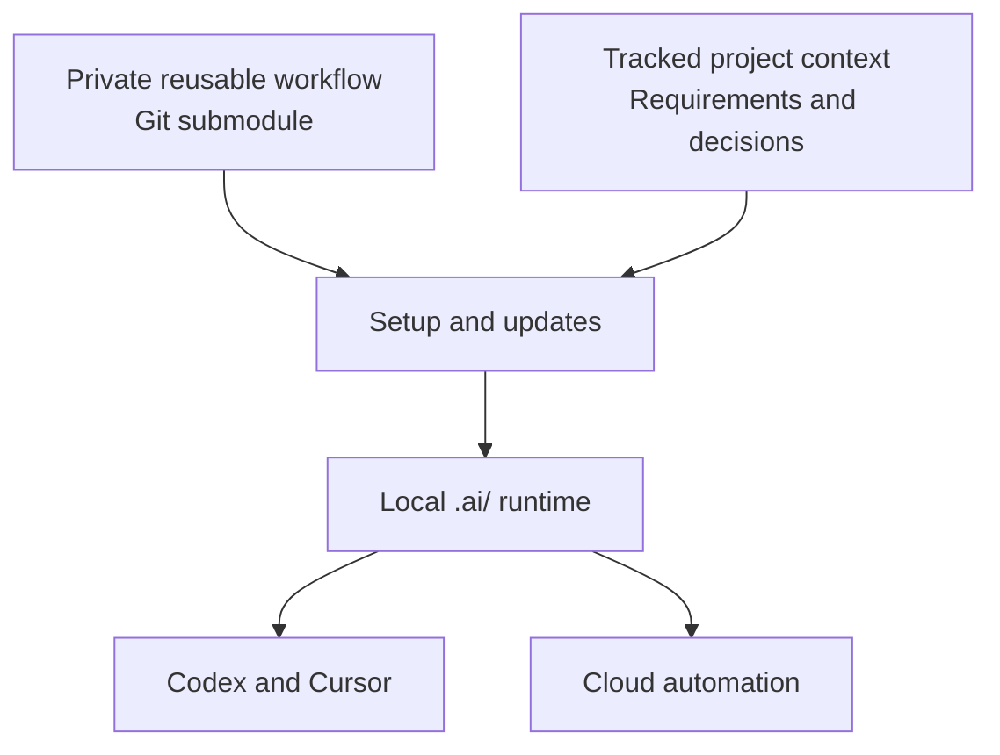
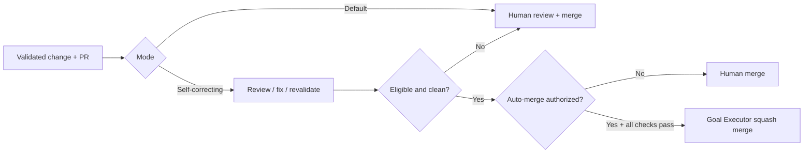

# AI Project Template Adapter

**Use one AI development workflow across projects and coding tools, while keeping the workflow private.**

I built this adapter to connect my private workflow to Codex, Cursor, and cloud automation. Each project keeps its own requirements and decisions, even when the shared workflow changes.

**What this repository shows:** the integration design, shell scripts, and automated tests. The private AI agents and their review logic are not included.

## How it works



The setup script downloads the private workflow, puts its instructions in `.ai/`, restores tracked project files, and sets up tool adapters and GitHub/GitLab issue templates.

## Workflow options

The private workflow supports **human review by default**, plus explicitly authorized self-correcting review and conditional auto-merge.



Independent review is preferred; self-review is the fallback. Risky or unresolved changes return to human review. The **supervised** option can request earlier checkpoints. For exact modes, conditions, and whole-project execution, see [Workflow modes and safeguards](docs/workflow-modes.md).

## Try the public adapter

**No private access required.** Clone this repository and run:

```bash
bash tests/test-adapter.sh
bash scripts/check-workflow-leak.sh
```

The first command tests setup and updates with a local fake workflow. The second checks for certain accidentally tracked private workflow files. It is **not** a secrets scanner.

[Read the technical review](docs/reviewer-guide.md) · [See setup code](scripts/setup-ai-workflow.sh) · [See tests](tests/test-adapter.sh)

## Use it in your own project (authorized users)

You need read access to my private `szymoniwacz/ai-project-template` repository.

1. Create a GitHub repository from this template and clone it.
2. Run setup and checks:

   ```bash
   ./scripts/setup-ai-workflow.sh
   ./scripts/ai-workflow-doctor.sh
   ./scripts/check-workflow-leak.sh
   ```

3. Add your project requirements and decisions under `.ai/project/`.
4. In Codex or Cursor, open the project. Follow the instructions in `.ai/README.md`. For an approved, scoped goal, use `/execute-goal` where the command is available.

To refresh the workflow:

```bash
./scripts/update-ai-workflow.sh
git status --short
git diff --submodule
```

**Before committing:** review changes. Do not commit copied private workflow instructions. GitHub and GitLab issue templates may be committed. Updating the submodule revision is a separate, explicit choice.

## Learn more

- [Reviewer guide](docs/reviewer-guide.md) — key decisions, test evidence, and limitations
- [Setup guide](docs/setup.md) — first use, updates, and requirements
- [Architecture](docs/architecture.md) — how components fit together
- [Workflow modes](docs/workflow-modes.md) — supervised, review, auto-merge and escalation
- [Automation setup](docs/automation-setup.md) — private workflow access in cloud runs
- [Full specification](docs/repository-specification.md) — detailed contract and invariants

CI runs on **Ubuntu only**. See [GitHub Actions](.github/workflows/ci.yml).

**Limit:** external reviewers can test the adapter, but cannot run my private workflow without access. These tests do not measure AI-generated code quality.

## License

MIT.
