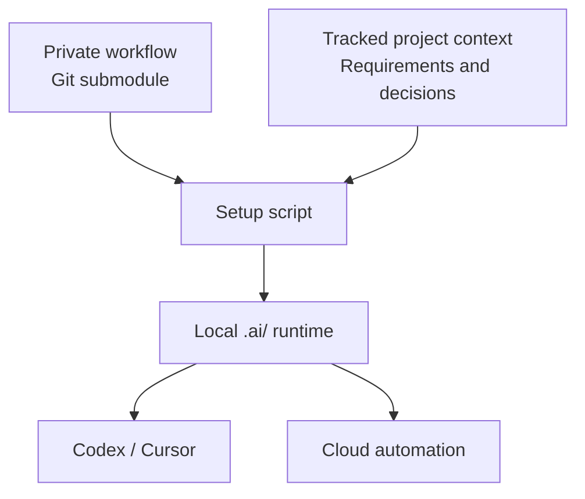
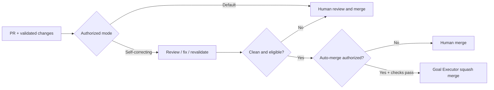

# AI Project Template Adapter

**One reusable AI development workflow across projects, Codex, Cursor, and automation — without committing private instructions to public Git history.**

I built this adapter to keep a single workflow up to date while preserving each project's requirements and decisions. The adapter is public; the workflow it loads is private.

## How it works



Setup refreshes the private submodule, copies its reusable files locally, preserves existing `.ai/project/` configuration and tracked project context, and prepares tool commands and GitHub/GitLab issue templates. Missing project defaults are seeded from the private workflow.

## Run the public tests

Anyone can clone this repository and verify the adapter **without private access**:

```bash
bash tests/test-adapter.sh
bash scripts/check-workflow-leak.sh
```

Tests use a local fake workflow; [Ubuntu CI](.github/workflows/ci.yml) runs the same checks. The leak check detects selected tracked files — **it is not a secrets scanner**.

## Install and use (authorized users)

Requires read access to the private `szymoniwacz/ai-project-template`.

1. Select **Use this template** on GitHub, create a project repository, and clone it.
2. Run setup and verify:

   ```bash
   ./scripts/setup-ai-workflow.sh
   ./scripts/ai-workflow-doctor.sh
   ./scripts/check-workflow-leak.sh
   ```

3. Confirm the doctor reports **`Status: ready`**.
4. Edit the tracked context, roadmap, and decision files in `.ai/project/`. New filenames may need `.gitignore` changes.
5. Open the repository in Codex or Cursor. Read `.ai/README.md` and use its workflow commands for an authorized task.

**Update later:**

```bash
./scripts/update-ai-workflow.sh
./scripts/ai-workflow-doctor.sh
git status --short
git diff --submodule
```

Review changes before committing. **Never commit the materialized private workflow.** Setup refreshes generated runtime files and issue templates; review or back up custom files in those destinations before running it. [Detailed setup and troubleshooting](docs/setup.md).

## Review and merge modes

The private workflow supports a **human-review default** and optional self-correcting review and authorized auto-merge:



Independent agent review is preferred; self-review is the fallback. Risky changes and unresolved blockers require human involvement. Project orchestration also supports dependency checks, duplicate-run coordination, and evidence-backed backlog audits. **[See commands, orchestration, safeguards, and diagrams](docs/workflow-modes.md).**

## Explore the implementation

**[Technical walkthrough](docs/reviewer-guide.md)** · [Setup script](scripts/setup-ai-workflow.sh) · [Contract tests](tests/test-adapter.sh) · [Architecture](docs/architecture.md) · [Automation setup](docs/automation-setup.md) · [Future ideas](docs/improvements.md) · [Specification](docs/repository-specification.md)

**Scope:** this repository demonstrates the integration architecture, not the private agent implementation or the accuracy of AI code review.

MIT License.
