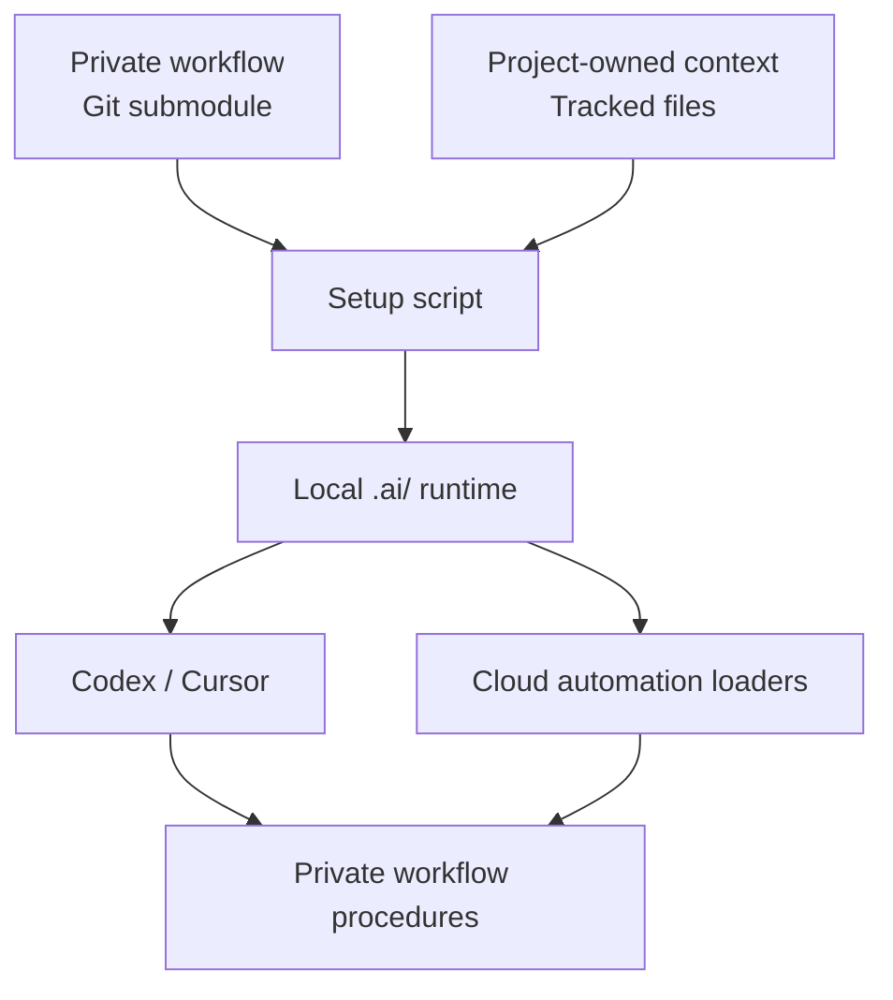

# Architecture

The adapter keeps **shared workflow instructions** separate from **project-specific files**.

- **Private submodule:** stores reusable instructions, skills, policies, and executors. Its contents are not committed to this public adapter.
- **Setup script:** refreshes the submodule, copies workflow files locally, restores tracked project context, and creates tool/issue adapters.
- **Local `.ai/`:** the shared entry point for agents after setup.
- **Project overlay:** tracked project files survive updates.
- **Cloud loaders:** delegate to the same private executor files; they do not copy executor logic.

If private access is missing, setup stops. The committed submodule revision can be updated separately.

[Workflow mode diagrams](workflow-modes.md) · [Reviewer guide](reviewer-guide.md) · [Setup](setup.md) · [Full specification](repository-specification.md)
