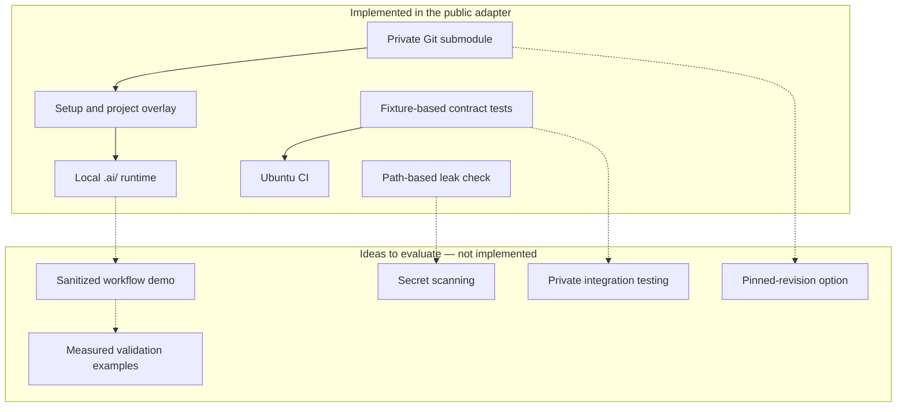

# Limitations and possible improvements

This page separates **verified limitations** from **ideas worth evaluating**. It is not a commitment or a delivery roadmap. No item below is presented as an approved future feature.

## Current state and possible next steps

| Area | Current state (verified) | Possible improvement (not yet committed) |
| --- | --- | --- |
| Public workflow demo | The adapter runs tests using a fake private workflow; outsiders cannot run the real workflow | Publish a sanitized, end-to-end example showing inputs, checks, review findings, and a PR without exposing private instructions |
| Leak protection | `check-workflow-leak.sh` detects specific tracked paths and obvious private-tree copies, not secrets within arbitrary files | Add a dedicated secrets scan and a pre-publication checklist |
| Private workflow compatibility | Manual setup checks with private access can exercise real-workflow materialization, but public CI uses only a fixture | Add a private, access-controlled integration job that tests selected workflow revisions; keep public CI independent of secrets |
| Version updates | Setup refreshes from the configured remote; the submodule reference is committed separately | Offer an explicit pinned-revision mode for reproducible setups, without changing the default silently |
| Custom generated files | Setup preserves existing `.ai/project/` files and restores tracked context elsewhere, but can still overwrite custom tool files and provider issue templates | Consider preflight warnings or preservation rules for custom tool files and provider issue templates |
| Quality evidence | Adapter tests prove integration behavior, not that AI-generated code is correct or private executor coordination works | Collect reproducible examples and measurable validation outcomes in a separate demo |

## How these improvements relate to the architecture

**Diagram key:** solid arrows describe existing connections; dashed arrows point to **possible future work**, not features delivered by this repository.

## Priority suggestion

1. **First:** a sanitized example is the most useful addition for an external reviewer who cannot access the private workflow.
2. **Next:** content-based secret scanning would strengthen the protection already provided by the path-based leak check.
3. **Later:** private integration checks, explicit version pinning, and measured quality examples may be useful depending on how often the workflow changes and who needs to run it.

These are recommendations based on the current adapter, **not confirmed personal plans**. Track an item as planned only after it has an approved issue or explicit decision.

[Back to README](../README.md) · [Architecture](architecture.md) · [Workflow options](workflow-modes.md)
