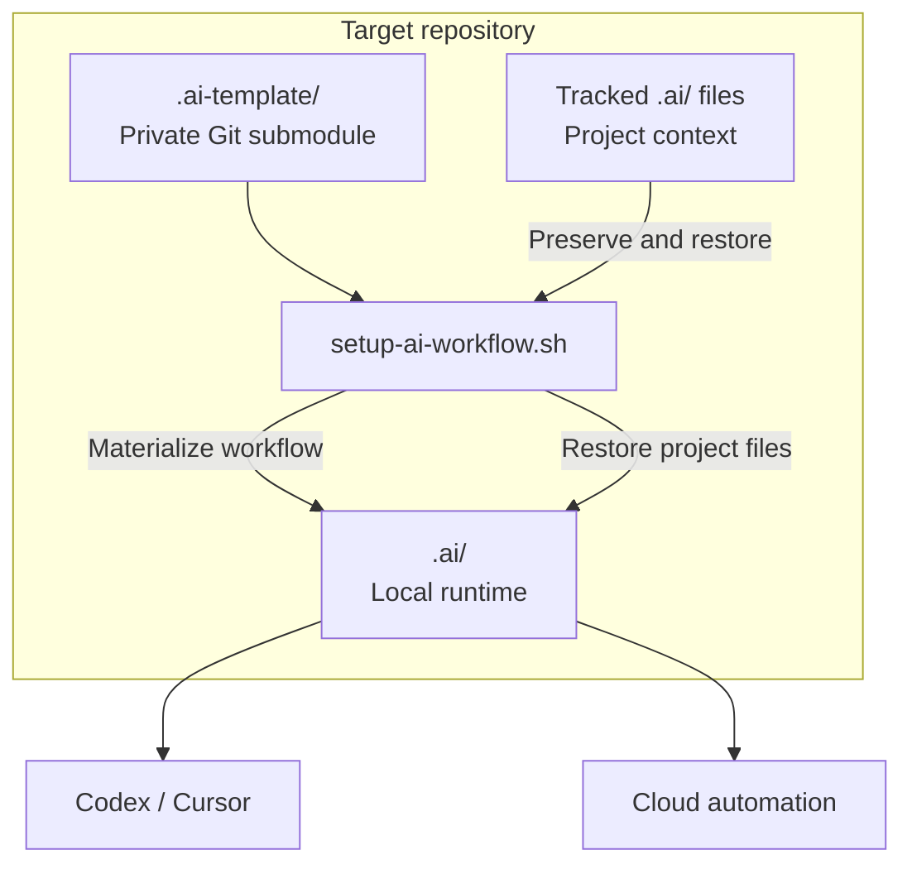
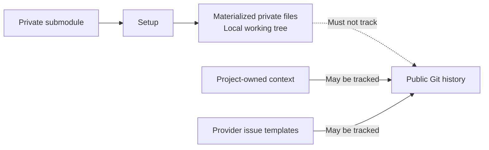

# AI Project Template Adapter — Repository Specification

## Status

This document is the source of truth for `szymoniwacz/ai-project-template-adapter`.

The adapter is a public GitHub template repository that connects generated target repositories to the private `szymoniwacz/ai-project-template` workflow without publishing that workflow.

This specification replaces the earlier runtime-delegation design based on `AI_PROJECT_TEMPLATE_HOME` and a private `bin/ai-workflow` entrypoint.

## 1. Goals

The adapter must let a repository created from this template use the following workflow integration architecture:



The design must satisfy all of the following:

1. The reusable AI workflow remains private.
2. Public target repositories may reference the private repository but must not commit its contents.
3. `.ai/` is the runtime source of truth seen by agents and automations.
4. Project-specific AI context survives workflow setup and upgrades.
5. The workflow revision used locally is visible and the target repository may record it through the submodule gitlink.
6. Local agents and cloud automations use the same workflow layout.
7. Missing access to the private workflow fails closed.
8. The adapter remains thin and does not duplicate Project Executor, Goal Executor, policies, prompts, or other reusable workflow logic.

## 2. Repository roles

### Private `szymoniwacz/ai-project-template`

Owns reusable workflow behavior, including `.ai/automation`, `.ai/policies`, `.ai/skills`, `.ai/workflows`, `.ai/review`, `.ai/git`, `.ai/instructions`, conventions, prompts, quality rules, onboarding material, and reusable tool entrypoint adapters under `.agents/skills/` and `.cursor/commands/`.

### Public `szymoniwacz/ai-project-template-adapter`

Owns only the integration contract:

- `.gitmodules` and the `.ai-template` gitlink,
- workflow setup/materialization,
- project-overlay preservation,
- leak protection,
- thin agent adapters,
- thin automation loaders,
- diagnostics,
- tests and documentation.

### Generated target repository

Owns the product and project-specific AI context: product context, roadmap, decisions, project requirements, ADRs, stack profile, ideas, and other target-specific documents.

## 3. Private submodule contract

Every target repository contains a git submodule at exactly:

```text
.ai-template
```

`.gitmodules` points to:

```text
https://github.com/szymoniwacz/ai-project-template.git
```

Setup updates the submodule checkout from its configured remote before materialization. The target repository may commit the resulting `.ai-template` gitlink when it wants to record that workflow revision explicitly.

A user without read access may see the private repository name and committed submodule identifier, but cannot retrieve the private repository contents through the submodule.

## 4. Runtime source of truth

`.ai-template/` is the private upstream source. It is not the path agents should normally follow.

After setup, `.ai/` is the runtime source of truth. Agent adapters must direct tools to `.ai/README.md` and the workflow paths materialized beneath `.ai/`.

This preserves the existing workflow assumptions used by Project Executor and Goal Executor, including paths such as:

```text
.ai/automation/project-executor.md
.ai/automation/goal-executor.md
.ai/skills/execute-goal.md
.ai/instructions/workflow.md
```

## 5. Materialization

`scripts/setup-ai-workflow.sh` is the canonical setup and refresh command.

It must:

1. resolve the target repository root,
2. initialize `.ai-template` when needed and update it from the configured remote,
3. verify the private workflow has the required structure,
4. save the target repository's tracked `.ai/**` files as project overlay,
5. materialize `.ai-template/.ai/` into `.ai/`, deleting stale template-owned files **outside** `.ai/project/` while preserving all existing project files there,
6. seed missing files under `.ai/project/` from the private workflow without overwriting existing files,
7. materialize `.ai-template/.agents/skills/` into `.agents/skills/`, `.ai-template/.cursor/commands/` into `.cursor/commands/`, `.ai-template/.gitlab/issue_templates/` into `.gitlab/issue_templates/`, and `.ai-template/.github/ISSUE_TEMPLATE/` into `.github/ISSUE_TEMPLATE/`,
8. restore the saved project overlay over the materialized workflow,
9. leave the private workflow materialized locally and ignored by default, while provider issue templates remain available to review and commit. Only explicitly allowed project context files should be tracked,
10. fail closed when the private workflow cannot be initialized, updated, or validated.

The setup command can be run repeatedly. **It is not a general backup mechanism:** `rsync --delete` can remove untracked project files beneath `.ai/` **outside `.ai/project/`**, and custom files (even tracked ones) in materialized tool/issue-template directories. Files already present in `.ai/project/` are not deleted or overwritten; missing project defaults are seeded from the private source. Review and back up such files before refresh.

## 6. Generic project overlay

The adapter must not contain DiffRat-specific filenames or paths.

The generic ownership rule is:

> Existing files under `.ai/project/` belong to the target project and are preserved, whether tracked or not. Missing files there may be seeded from the private workflow. Outside `.ai/project/`, only tracked `.ai/**` files are preserved as project-owned overlay; other materialized files are refreshable runtime.

Setup preserves the current working-tree contents of tracked `.ai/**` files, not only `HEAD`, so local edits are not silently discarded. Untracked `.ai/project/` files also survive setup, but must be explicitly committed to persist across clones; ignored files require an intentional `git add -f` or a project-specific `.gitignore` change.

The default `.gitignore` explicitly unignores a **small set** of project-owned files under `.ai/project/`, plus `.ai/docs/project-requirements.md`. Private-seeded `alignment.yaml` remains ignored by default. After customization, a project owner can explicitly track it with `git add -f .ai/project/alignment.yaml`, after reviewing its contents. It does **not** automatically allow every file under `.ai/project/` or other recommended context folders.

To track additional project context (for example ADRs or stack profiles), update `.gitignore` to unignore the directory and files, and check that the paths are allowed by `scripts/check-workflow-leak.sh`. Review the diff before committing. The leak check's path allowlist and Git's ignore rules serve different purposes.

The initial adapter seeds minimal files under `.ai/project/`; each generated repository owns their content.

## 7. Git ignore and leak model

Materialized private workflow files may exist locally. Their existence is expected.

The security boundary is **Git tracking**, not the presence of files on disk. The dashed connection below is prohibited:



The repository therefore ignores known reusable materialized paths, including `.agents/skills/` and `.cursor/commands/`, while explicitly allowing project-owned overlay paths. GitHub and GitLab issue templates are not ignored because each provider reads them from the target repository's default branch.

`scripts/check-workflow-leak.sh` must fail when:

- reusable `.ai/**` materialized files are tracked outside the project-owned allowlist,
- `.ai-template` is not represented as the expected gitlink when present in the repository,
- an obvious root-level copy of the private workflow tree is tracked outside the submodule.

This check works on **tracked paths**, not content, and must not be treated as a comprehensive protection against publishing private text. It does not detect arbitrary credentials, sensitive project data, or private text copied into otherwise allowed files. It must not fail merely because setup has materialized private workflow files locally. A separate secret scanner and human review of changed files are required before publishing code or project context.

## 8. Thin agent adapters

`AGENTS.md`, `CLAUDE.md`, Cursor rules, and GitHub Copilot instructions are public thin adapters.

Repo-scoped Codex skills and Cursor commands are materialized from `szymoniwacz/ai-project-template` so they stay synchronized with the canonical workflow.

They must not reproduce reusable workflow rules. Their role is to tell the agent:

1. run setup when `.ai/README.md` is not materialized,
2. treat `.ai/` as source of truth,
3. read `.ai/README.md` first,
4. follow the private workflow documents from `.ai/`.

## 9. Automation loaders

Cloud automations cannot assume private `.ai/automation/*.md` is committed on `origin/main` of a public target repository.

The adapter therefore contains public thin loaders under `docs/ai-workflow/`.

A loader may:

1. verify the private submodule/workflow is available in the automation workspace,
2. run or require workflow setup,
3. verify the materialized executor files exist,
4. load the private Project Executor or Goal Executor document,
5. delegate completely to that document.

A loader must not duplicate executor state machines, authorization rules, review rules, or merge rules.

If private workflow access is unavailable, the loader must not perform executor-driven repository changes or remote writes. Bootstrap may still make local Git/submodule changes before reporting a failure.

## 10. Authentication

The submodule solves workflow location and versioning, not authorization.

Any local or cloud environment that needs the workflow must have read access to `szymoniwacz/ai-project-template`.

Credentials must never be committed to the adapter or target repository. Cloud automation credentials belong in the automation provider's secret/runtime configuration.

A user without access should receive a clear setup failure and no fallback implementation. The failed command may already have made local Git/submodule changes; fail-closed here means no private executor logic runs, not an atomic rollback of bootstrap.

## 11. Workflow upgrades

Setup refreshes the configured private workflow remote and rematerializes `.ai/`:

```text
./scripts/setup-ai-workflow.sh
```

The adapter may provide a helper script that reports the old and new revisions, but neither setup nor the helper may commit automatically.

After refresh, the target repository may commit the changed `.ai-template` gitlink when it wants to record that workflow revision explicitly.

## 12. Diagnostics

`scripts/ai-workflow-doctor.sh` checks:

- that it can resolve the repository root,
- that `.gitmodules` defines a submodule path named `.ai-template`,
- that `.ai-template/.ai/README.md`, `.ai-template/.ai/automation/project-executor.md`, and `.ai-template/.ai/automation/goal-executor.md` exist,
- that the materialized `.ai/README.md` and project-owned `.ai/project/product-context.md` exist,
- that `scripts/check-workflow-leak.sh` succeeds.

If the submodule has Git metadata, the doctor also reports its current short commit revision. This is informational, not an additional readiness gate.

The doctor reports `Status: ready` only if all checks pass; otherwise it reports `Status: not ready`. It does **not** validate the complete private workflow structure, execute the workflow, or independently verify the submodule gitlink beyond the separate path-based leak check.

## 13. Tests

Public adapter contract tests use a local fake private workflow fixture, never the real private repository.

Contract coverage includes:

1. materialization and initialization of the submodule,
2. refresh to a newer configured remote revision,
3. failure when required submodule configuration is missing,
4. preservation of tracked project overlay, including uncommitted edits,
5. removal of stale template-owned files and successful repeated setup,
6. rejection of selected accidentally tracked private paths,
7. invocation from a nested directory,
8. update-helper delegation to setup and refresh of provider templates,
9. Codex/Cursor adapter and GitHub/GitLab issue-template materialization.

The repeated-setup test confirms successful runs; it does **not** compare complete filesystem trees to prove strict idempotency. The tests do not assert the update helper's printed old/new revision summary. Ubuntu CI executes these contract tests, but does not run the real private workflow or independently exercise every missing-required-file validation path.

## 14. Invariants

The following are architectural invariants:

A. Private workflow contents must never be tracked in a public target repository; the path-based guard alone cannot guarantee this.

B. `.ai-template` is the single upstream reusable workflow source.

C. `.ai/` is the runtime source of truth.

D. Tracked project overlay survives every setup and workflow update.

E. Updating the private workflow does not overwrite project-owned context.

F. Private workflow unavailable means fail closed.

G. Public loaders never implement Project Executor or Goal Executor logic, including newer private coordination and state-recovery rules.

H. Local and cloud execution use the same materialized workflow layout.

I. Setup refreshes `.ai-template` from its configured remote before materialization; the gitlink may record the selected revision when committed.

J. The adapter does not maintain a second runtime-delegation architecture.

## 15. Out of scope

The adapter does not:

- publish or vendor private workflow files,
- provide a public fallback workflow,
- implement Project Executor or Goal Executor itself,
- automatically commit workflow upgrades,
- solve provider-specific secret provisioning in code,
- copy DiffRat-specific project context into generated repositories.

## 16. Target bootstrap

The desired target-repository bootstrap is intentionally small:

```bash
./scripts/setup-ai-workflow.sh
```

The script initializes or updates the private submodule and materializes the workflow. The user then customizes tracked project context and can use the normal AI workflow, including `/execute-goal` and `/execute-project` when the corresponding automation environment has private-repository access.
