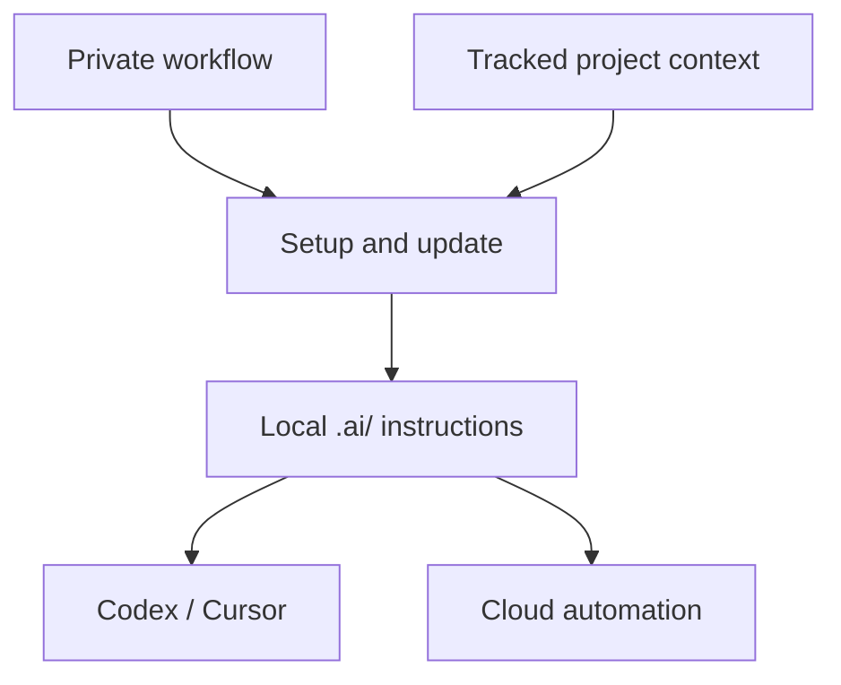

# Technical reviewer guide

**Purpose:** explain the design of this public adapter in a few minutes.

## Problem and solution

I use one AI-assisted development workflow in multiple projects. Copying the same instructions into each project would make updates difficult and could overwrite project-specific requirements.

This adapter solves that by keeping the workflow in a private Git repository and loading it into each project. The project keeps its own tracked context.



## Design choices

| Choice | Why | Code |
| --- | --- | --- |
| Private Git submodule | Reuse one source without publishing it | [`.gitmodules`](../.gitmodules) |
| Local `.ai/` folder | Give coding tools the same instructions | [Setup](../scripts/setup-ai-workflow.sh) |
| Tracked project files | Keep requirements and decisions across updates | [Setup](../scripts/setup-ai-workflow.sh), [Tests](../tests/test-adapter.sh) |
| Stop when private access fails | Never silently substitute missing instructions | [Setup](../scripts/setup-ai-workflow.sh) |
| Small automation loaders | Keep executor rules in one private source | [Goal loader](ai-workflow/goal-executor-loader.md), [Project loader](ai-workflow/project-executor-loader.md) |
| Fake-workflow tests | Test integration without exposing private code | [Tests](../tests/test-adapter.sh) |

## What you can verify

Clone the public repo and run:

```bash
bash tests/test-adapter.sh
bash scripts/check-workflow-leak.sh
```

The tests cover installation, updates, repeated setup, project-file preservation, error handling, and generating tool/issue adapters. [GitHub Actions](../.github/workflows/ci.yml) runs them on Ubuntu.

**Do not run production setup without private repository access.** That command is for authorized projects only.

## How this relates to agentic development

This code does not implement an AI coding or review agent. It provides the integration layer for a private workflow that separates implementation, validation, and review. You can inspect how I manage reusable instructions, project context, and failure handling without access to the private agent logic.

## Workflow options

The private workflow includes human review by default, an opt-in self-correcting review loop, and conditional, explicitly authorized squash merge. Independent agent review is preferred, with self-review as fallback. High-risk work escalates to human review rather than agent merge.

[See the workflow-mode diagrams, supported commands, and safeguards](workflow-modes.md). These diagrams document design intent; the underlying agent implementations are private.

For a clear distinction between current limitations and ideas still under consideration, see [possible improvements](improvements.md).

## Trade-offs

- **Private code:** the full workflow cannot be tested by public reviewers.
- **Updates:** setup refreshes from the configured remote; the submodule commit can be recorded separately for version tracking.
- **Security:** the leak check is path-based, not a complete secrets scan. Review public changes before publishing.
- **Evidence:** tests prove adapter behavior with a fake workflow, not code-review accuracy.

[Setup instructions](setup.md) · [Architecture](architecture.md) · [Full specification](repository-specification.md)
