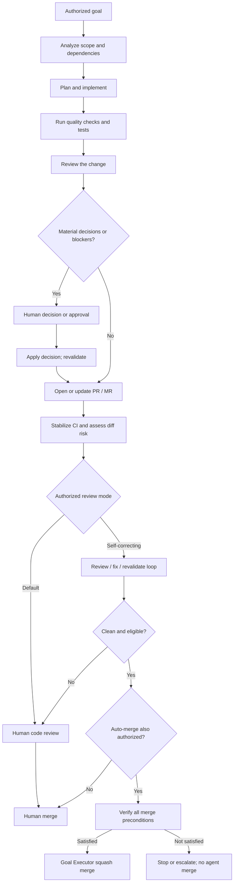
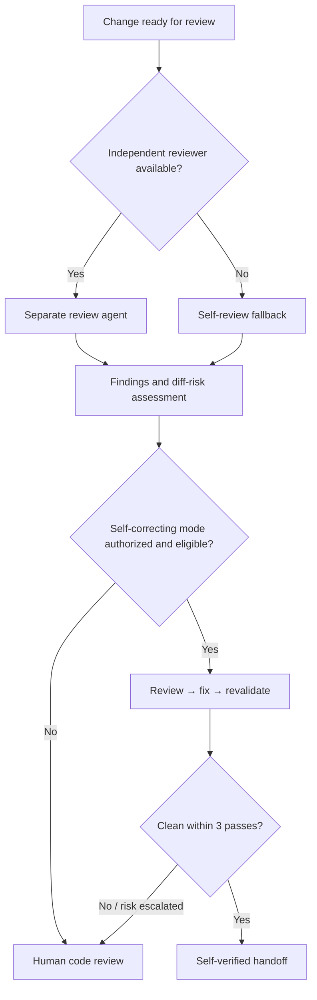

# Workflow modes and review paths

This page describes the **high-level behavior of my private AI workflow**. It is a design overview, **not executable code** or evidence that an AI reviewer will catch every defect. The public adapter only loads the private workflow into authorized project repositories.

## Goal lifecycle

The diagrams simplify internal stages; actual execution follows the private authorization and quality policies. Work also stops for unresolved required approvals or external blockers. A failure to finish the loop does **not** authorize skipping human review.

## Available options

| Option | How to request it | Review and merge outcome |
| --- | --- | --- |
| **Default** | `/execute-goal` | Autonomous work through review-ready PR; human code review and human merge |
| **Supervised** | Explicitly request a checkpoint or earlier stop | Work stops at the requested boundary, including before commit/push when requested |
| **Self-correcting review** | `/execute-goal self-correcting-review` | Review/fix loop; eligible clean changes may skip human code review; human merge remains required |
| **Self-correcting review + auto-merge** | `/execute-goal self-correcting-review auto-merge` | Eligible, clean changes may be squash-merged by Goal Executor after required checks |
| **Whole-project execution** | `/execute-project` with the same optional review suffixes | Project Executor delegates one goal at a time to Goal Executor; it never merges itself |

The forms above describe authorized issue comments or supported local commands; local issue references may also be required. These modes are **opt-in where stated**. Merely including a label in a project file does not grant authorization.

### Review behavior

Independent review is **preferred, not guaranteed**. The self-correcting loop has a **maximum of three passes**. High diff-risk, security-sensitive changes, unresolved issues, or required human approvals lead to escalation rather than agent merge.

### Merge safeguards

Agent squash merge is possible **only** with the explicit `self-correcting-review auto-merge` option, a clean eligible review loop, applicable CI green (or no applicable CI), and no outstanding material or safety blockers. It is **not** GitHub's auto-merge queue. Default and escalated paths require human merge.

## Related references

- [Public adapter architecture](architecture.md)
- [Technical reviewer guide](reviewer-guide.md)
- [Setup instructions](setup.md)
- [Limitations and possible improvements](improvements.md)

**Visibility boundary:** this page intentionally describes mode names and observable control flow only. The private prompts, policies, internal executor state machines, and implementation remain in the private repository.
